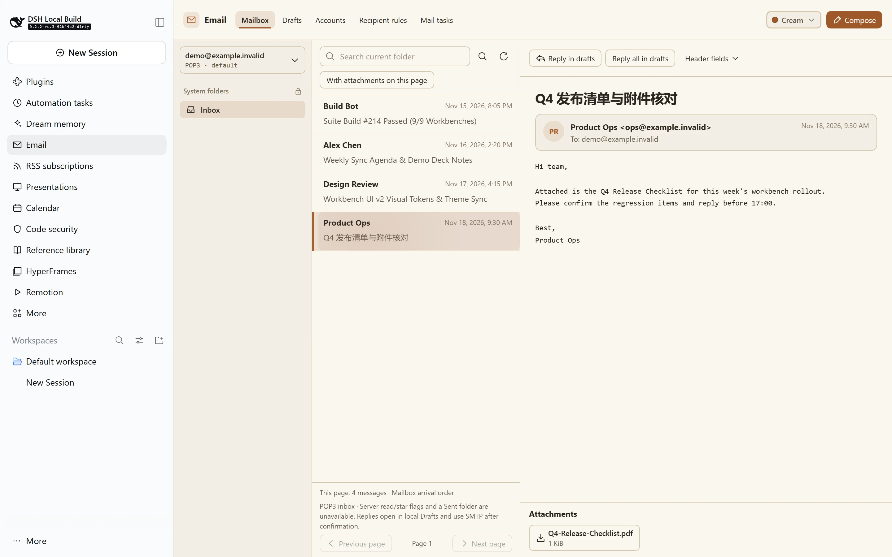

[简体中文](README.md) · **English**

# Email

**DeepSeek Harness email workbench: default tactile Letter Desk (`Desk`) with 1-click toggle to classic `3-Pane`, safe rich replies, local Contacts pinyin autocomplete, interactive Whale-Girl Courier, and 13 bright styles + 8 dual-layer fonts.**

[](https://www.npmjs.com/package/dsh-email) [](https://www.npmjs.com/package/dsh-email) [](https://www.npmjs.com/package/dsh-email)

**[Install](#install) · [Workflow](#start-using-it) · [Full guide](https://github.com/STARDUSTLC666/dsh-email/blob/main/docs/REFERENCE.en.md)**

<picture>
  <source media="(prefers-color-scheme: dark) and (max-width: 640px)" srcset="https://raw.githubusercontent.com/STARDUSTLC666/dsh-email/main/docs/assets/intro/workflow-en-mobile-dark.svg">
  <source media="(max-width: 640px)" srcset="https://raw.githubusercontent.com/STARDUSTLC666/dsh-email/main/docs/assets/intro/workflow-en-mobile-light.svg">
  <source media="(prefers-color-scheme: dark)" srcset="https://raw.githubusercontent.com/STARDUSTLC666/dsh-email/main/docs/assets/intro/workflow-en-dark.svg">
  
</picture>

## Features

Supports the bespoke **Letter Desk (`Desk`)** tactile stacked airmail workbench with 1-click switch back to classic **3-Pane**, safe HTML send/reply/draft previews, reviewed scheduled sends, Google & Outlook OAuth, Tencent enterprise mail presets, localized reply quotations, optional mail-triggered DSH tasks, interactive Whale-Girl **Courier**, **13 switchable bright/soft workbench styles** (Native Airy, Warm Cream, Claude Warmth, Bright 8-Bit, Airy Mint, Daylight Glass, E-Ink Paper, Blueprint, Riso Zine, Retro 98, Song Xuan, Aqua Gloss, Gazette), and **8 dual-layer font pairings (default: YouYuan Mono)** adapted for DeepSeek Harness `>=0.2.2-rc.3`. See the [workflow and operating boundaries](docs/OUTGOING-AUTOMATION.en.md). Existing Gmail app-password accounts continue to work. Scheduling requires a running DSH; task execution and automatic result replies are opt-in.

- Use IMAP/POP3/SMTP, Outlook OAuth or AgentMail accounts.
- Besides built-in providers and server presets, the provider dropdown offers **Custom server (enter details)**: enter IMAP/SMTP endpoints directly for intranet or self-hosted mail servers. A blank outgoing host reuses the incoming host, and blank ports default to 993/465.
- **Letter Desk (`Desk` default) & 3-Pane toggle**: triage stacked airmail Letter Cards by dragging left to skip or right to unfold full stationery, 3D-flip to inspect raw envelope metadata, or switch back to the classic 3-Pane folder tree with per-folder unread counts and resizable split panes in 1 click. Click **`? Tour`** in the header anytime for a spotlight guide.
- **Interactive Whale-Girl Courier**: click **Courier** in the topbar to summon her anytime — pat her head for 3 mood expressions & particle effects, check for new mail live, or jump straight to your mailbox.
- A local address book collects correspondents as you read, renders senders and recipients by contact name, and offers autocomplete for To/Cc by name, address, full pinyin, pinyin initials or 工号 (so `张小`, `zxm`, `zhangxiaoming` and `100123` all reach the same colleague), filling in `Name <address>`; everything stays on this machine in a local SQLite file.
- Review the sender, To/Cc, content and attachments before confirming.
- Run in Chinese, English, Spanish, French, German, Japanese, Brazilian Portuguese or Russian, using the DSH locale runtime.
- Subscribe in-process to mailbox arrivals through `emailTasks`, without reading bodies or starting sessions.

<details>
<summary>See a workbench example</summary>



Captured with `dsh-email 0.32.0` running in Harness Web `0.2.2-rc.3` (Letter Desk tactile airmail stack + default YouYuan Mono font, controlled validation data).

</details>

Formatted reading, longer quoted replies, and IMAP single/bulk Trash with Undo: see the [mailbox workflow](docs/MAILBOX.en.md). You choose whether to load external images and confirm moves before they run.

## Install

Open **Plugins** in the DSH desktop app and install `dsh-email`. If the CLI is available:

```bash
dsh plugin --profile desktop add dsh-email
```

For the web profile, replace `desktop` with `web`. Restart that DSH profile after installation. The package’s DSH requirement is `>=0.2.2-rc.3`.

## Start using it

**Human-in-the-loop workflow: Connect mailbox → Triage on Letter Desk → Summon Courier / AI drafts → Review & send** (click **`? Tour`** in the topbar anytime for a spotlight walkthrough):

1. **Connect mailbox**: Open **Email → Accounts**, choose your IMAP/POP3/SMTP provider, Google/Outlook OAuth, AgentMail, or a custom server, sign in or paste an app password, and click **Test connection**.
2. **Triage & read on the Letter Desk (`Desk` default, 1-click back to `3-Pane`)**:
   - **Mailbox** opens into the **Letter Desk**: the compact top ribbon combines account & folder tree switching (with unread badges), keyword search, **Unread only**, **With attachments**, a remaining counter, and the 1-click **Desk / 3-Pane** toggle.
   - Triage stacked airmail Letter Cards by dragging **left to skip** or **right to unfold full stationery**; click **Envelope header** (or press `Space`/`F`) to 3D-flip to raw server headers, or click **Unfold full letter** for formatted reading, attachment downloads, and replies (external tracking images stay blocked until you opt in per message).
3. **Interactive Whale-Girl Courier & AI drafts**: Click **Courier** in the topbar to summon the whale-girl for headpat expressions or live **Check mail**; copy the 1-click prompt in `? Tour` (or ask in Chat) so the assistant summarizes unread tasks or saves reply drafts in **Drafts** without sending prematurely.
4. **Compose with autocomplete, review & personalize**: Click **Compose** or open **Drafts** (with local Contacts pinyin/ID autocomplete for To/Cc), preview HTML/plain text, recipients, attachments, and sending account, then confirm **immediate** or **scheduled** delivery (recipient block rules always take precedence). Switch live across **13 bright styles** and **8 dual-layer fonts (`字`, default: YouYuan Mono)** synced across all DSH plugins.

You can also ask directly in Chat:

- > Summarize important unread emails in my work account and list the replies needed without sending anything.
- > Draft a polite, concise reply to the open message in Drafts so I can review it before sending.

## Before you start

Bring your mailbox authorization or AgentMail API key. POP3 has protocol-specific state and search limits. When the network only reaches a mail server through a proxy, add `proxy` to the account (or set `HTTPS_PROXY`); see the [usage guide](https://github.com/STARDUSTLC666/dsh-email/blob/main/docs/USAGE.en.md).

Configuration, detailed tools and troubleshooting: [full reference](https://github.com/STARDUSTLC666/dsh-email/blob/main/docs/REFERENCE.en.md).

## Plugin updates

Check updates at the bottom of the workbench or native plugin details. Automatic checks are on by default; **automatic installation is off**. You choose whether to install and when to restart. Suite-managed components update with their bundle. [Update behavior](https://github.com/STARDUSTLC666/dsh-email/blob/main/docs/REFERENCE.en.md).

## Documentation

- [Full usage, configuration and limits](https://github.com/STARDUSTLC666/dsh-email/blob/main/docs/REFERENCE.en.md)
- [Release notes](https://github.com/STARDUSTLC666/dsh-email/blob/main/CHANGELOG.md)
- [Validation scope and history](https://github.com/STARDUSTLC666/dsh-email/blob/main/docs/VALIDATION.md)

## Feedback and contributions

If the plugin helps, a Star makes it easier for others to discover. Report problems or suggest improvements in [Issues](https://github.com/STARDUSTLC666/dsh-email/issues); code and documentation [PRs](https://github.com/STARDUSTLC666/dsh-email/pulls) are welcome. Include versions and reproduction steps, and remove credentials from reports.

## License

[MIT](https://github.com/STARDUSTLC666/dsh-email/blob/main/LICENSE)

<a id="what-it-does"></a>
<a id="requirements-and-configuration"></a>
