[简体中文](README.md) · **English**

# Email

> **Manage multi-account mail in DeepSeek Harness and review every draft before immediate or scheduled delivery.**

Opens in the tactile **Letter Desk (`Desk`)** airmail stack with 1-click switch to classic **3-Pane**, featuring full-protocol accounts, local SQLite pinyin Contacts autocomplete, interactive Whale-Girl **Courier**, and 13 bright styles × 8 fonts.

[](https://www.npmjs.com/package/dsh-email) [](https://www.npmjs.com/package/dsh-email) [](https://www.npmjs.com/package/dsh-email)

**[Launch Film](#launch-film) · [Features](#features) · [Interface & Theme Previews](#interface--theme-previews) · [Install](#install) · [Workflow](#start-using-it) · [Full guide](https://github.com/STARDUSTLC666/dsh-email/blob/main/docs/REFERENCE.en.md)**

<picture>
  <source media="(prefers-color-scheme: dark) and (max-width: 640px)" srcset="https://raw.githubusercontent.com/STARDUSTLC666/dsh-email/main/docs/assets/intro/workflow-en-mobile-dark.svg">
  <source media="(max-width: 640px)" srcset="https://raw.githubusercontent.com/STARDUSTLC666/dsh-email/main/docs/assets/intro/workflow-en-mobile-light.svg">
  <source media="(prefers-color-scheme: dark)" srcset="https://raw.githubusercontent.com/STARDUSTLC666/dsh-email/main/docs/assets/intro/workflow-en-dark.svg">
  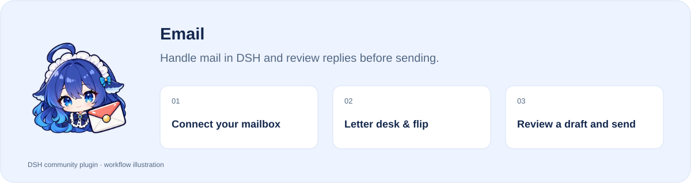
</picture>

## Launch Film

<p align="center">
  <a href="https://github.com/STARDUSTLC666/dsh-email/blob/main/assets/promo/dsh-email-v1.0.0-promo-1080p.mp4" title="Watch the full 1080p launch film with audio (81.6s)">
    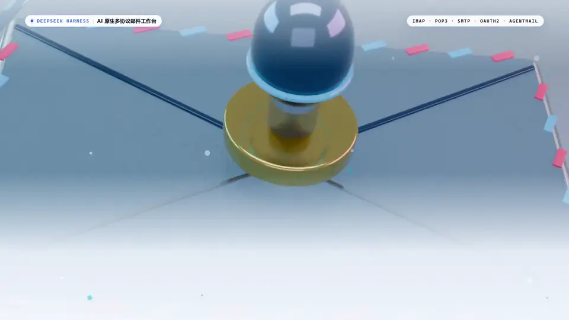
  </a>
</p>

<p align="center">
  <strong><a href="https://github.com/STARDUSTLC666/dsh-email/blob/main/assets/promo/dsh-email-v1.0.0-promo-1080p.mp4">▶ Watch Full 1080p Launch Film with Audio (81.6s · MP4)</a></strong>
  &nbsp;·&nbsp;
  <a href="https://raw.githubusercontent.com/STARDUSTLC666/dsh-email/main/assets/promo/dsh-email-v1.0.0-cover.webp">View Poster Cover</a>
  <br>
  <sub>Highlights the 3-layer tactile Letter Desk & 3D header flip, 6-layer zero-credential server discovery, 1-click classic 3-Pane, <code>tools/pre-execute</code> send approval gate, local SQLite 50K pinyin Contacts & 13 themes × 8 fonts. BGM: <em>Lights</em> by Sappheiros (<a href="https://www.free-stock-music.com/">Free Stock Music</a>, <a href="https://creativecommons.org/licenses/by/3.0/">CC BY 3.0</a>, trimmed/edited for runtime)</sub>
</p>

## Features

| Pillar | Capabilities |
| :--- | :--- |
| **Multi-Protocol Accounts** | IMAP / POP3 / SMTP, Google & Outlook OAuth, AgentMail, Tencent enterprise presets, **one-click server auto-detection** (offline DB / MX / SRV / Autoconfig / ISPDB), plus manual **Custom server** endpoints |
| **Letter Desk (`Desk`) Triage** | Stacked airmail cards (drag left to skip, right to unfold, `Space`/`F` 3D-flip to raw headers) with 1-click switch to classic **3-Pane** folder trees & unread badges, plus a Gmail-style one-line **List** view that reads in place without a third pane |
| **Safe Reading & Delivery** | Blocks external tracking images by default; preview HTML/plain drafts, recipients & attachments before immediate or scheduled send, with undoable IMAP Trash |
| **Local Contacts Autocomplete** | Learns correspondents locally in SQLite and autocompletes To/Cc by name, email, full pinyin, pinyin initials, or employee ID |
| **Courier, Locales & Hooks** | Interactive Whale-Girl **Courier** for live mail checks; 8 UI languages, 13 styles × 8 fonts, in-process `emailTasks` arrivals & opt-in mail-triggered DSH tasks |

## Interface & Theme Previews

All 9 live captures below were taken from a controlled local IMAP/SMTP verification workbench in DSH Web (covering Letter Desk, 3D header flip, classic 3-Pane, server auto-discovery, deny-first recipient policies, local SQLite pinyin autocomplete, and refreshed themes with synthetic data). Click any image to view full size.

<table>
<tr>
  <th>Letter Desk Airmail Stack (Frutiger)</th>
  <th>3D Flip to Raw Envelope Headers</th>
  <th>Classic 3-Pane · Tracker Shield · Inline Chart</th>
</tr>
<tr>
  <td width="33%"><a href="https://raw.githubusercontent.com/STARDUSTLC666/dsh-email/main/assets/gallery/v100-desk-frutiger-zh.webp">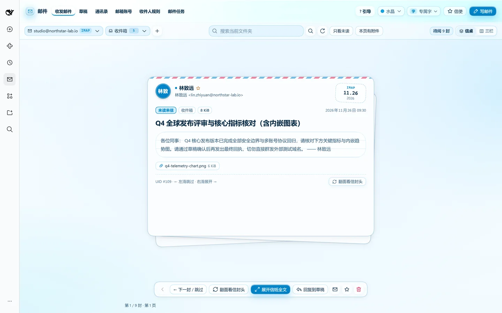</a></td>
  <td width="33%"><a href="https://raw.githubusercontent.com/STARDUSTLC666/dsh-email/main/assets/gallery/v100-desk-flipped-zh.webp">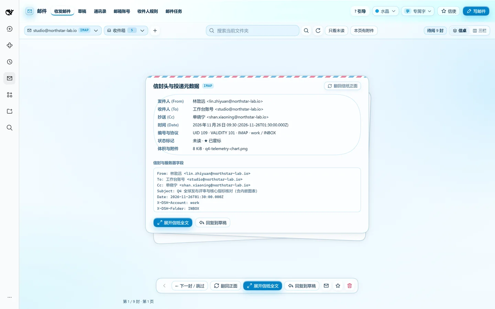</a></td>
  <td width="33%"><a href="https://raw.githubusercontent.com/STARDUSTLC666/dsh-email/main/assets/gallery/v100-threepane-imap-zh.webp">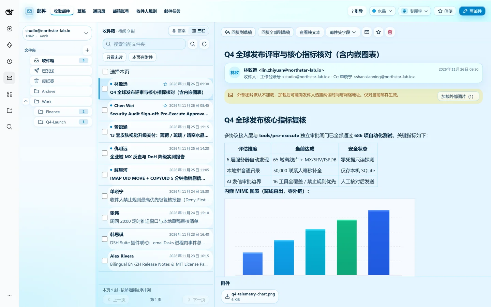</a></td>
</tr>
<tr>
  <th>Multi-Protocol Accounts & Auto-Discovery</th>
  <th>Deny-First Recipient Policy & Dry-Run Check</th>
  <th>Local SQLite Pinyin & Employee-ID Autocomplete</th>
</tr>
<tr>
  <td width="33%"><a href="https://raw.githubusercontent.com/STARDUSTLC666/dsh-email/main/assets/gallery/v100-accounts-autodiscover-zh.webp">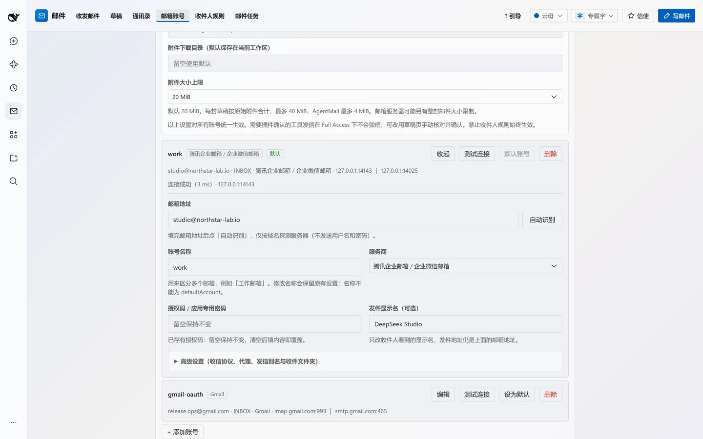</a></td>
  <td width="33%"><a href="https://raw.githubusercontent.com/STARDUSTLC666/dsh-email/main/assets/gallery/v100-policy-approval-zh.webp">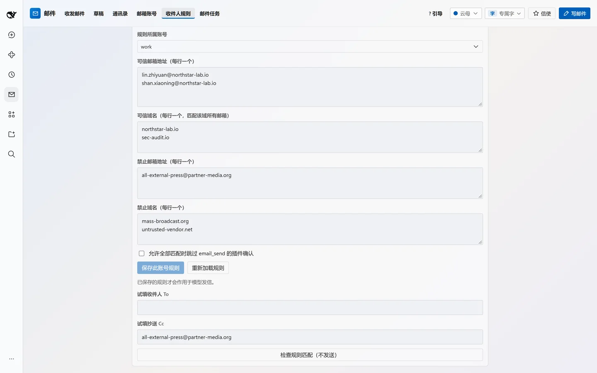</a></td>
  <td width="33%"><a href="https://raw.githubusercontent.com/STARDUSTLC666/dsh-email/main/assets/gallery/v100-compose-pinyin-zh.webp">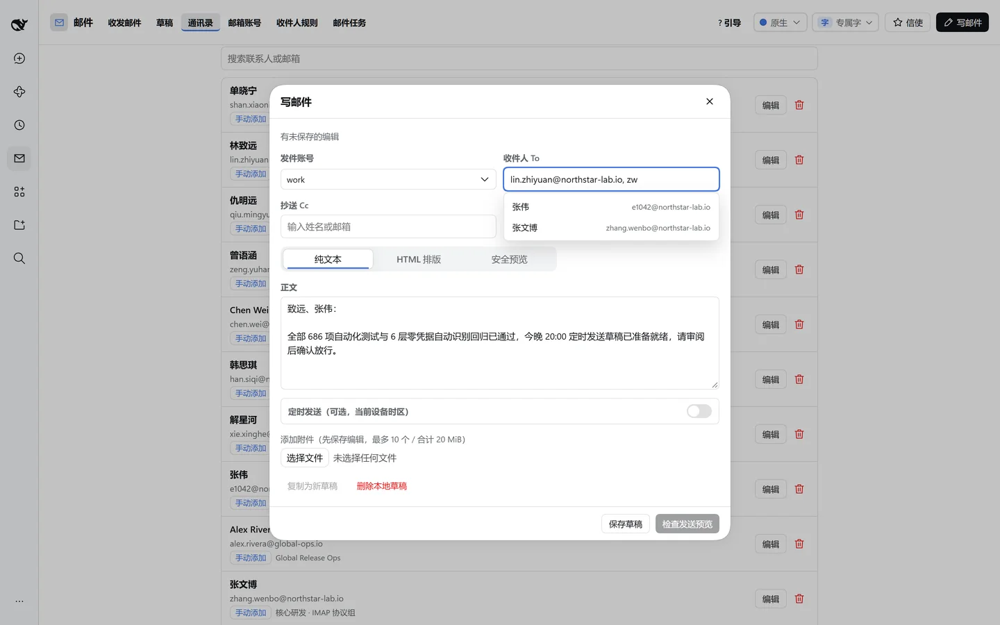</a></td>
</tr>
<tr>
  <th>Theme Preview: Airy Mint</th>
  <th>Theme Preview: Songhui Vermilion</th>
  <th>Theme Preview: Blueprint</th>
</tr>
<tr>
  <td width="33%"><a href="https://raw.githubusercontent.com/STARDUSTLC666/dsh-email/main/assets/gallery/v100-skin-mint-zh.webp">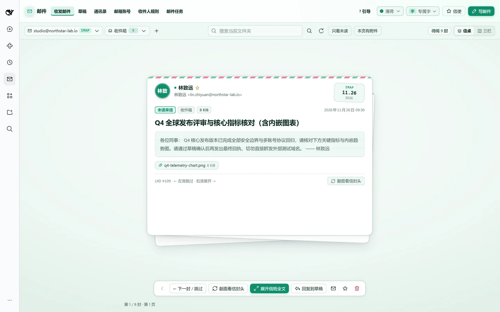</a></td>
  <td width="33%"><a href="https://raw.githubusercontent.com/STARDUSTLC666/dsh-email/main/assets/gallery/v100-skin-songhui-zh.webp">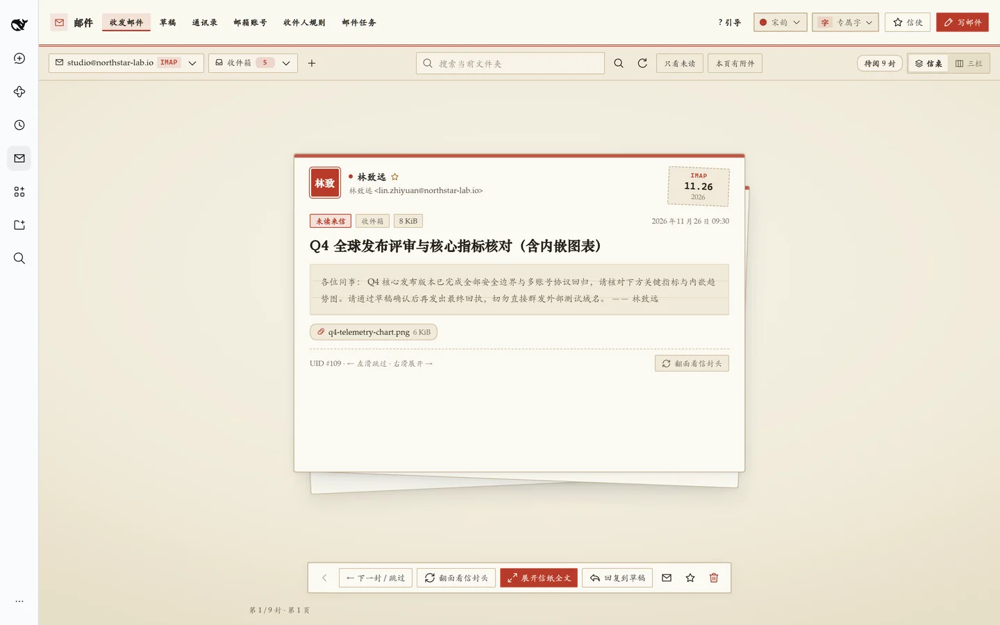</a></td>
  <td width="33%"><a href="https://raw.githubusercontent.com/STARDUSTLC666/dsh-email/main/assets/gallery/v100-skin-blueprint-zh.webp">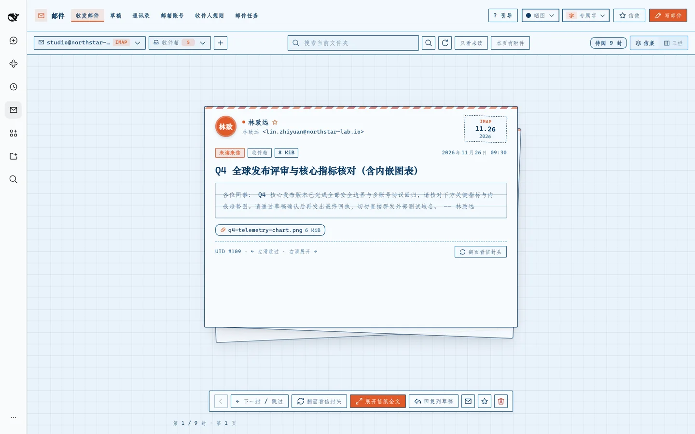</a></td>
</tr>
</table>

## Install

Open **Plugins** in the DSH desktop app and install `dsh-email`, or use the CLI:

```bash
dsh plugin --profile desktop add dsh-email
```

For the web profile, replace `desktop` with `web` and restart DSH. Requires DSH `>=0.2.2-rc.3`.

## Start using it

1. **Connect mailbox**: Open **Email → Accounts**, pick a provider, OAuth, AgentMail, or custom server, run **Test connection**, and save.
2. **Triage on Letter Desk**: Filter by account, folder, unread, or attachments; drag left to skip, right to unfold, or press `Space`/`F` to inspect raw headers (toggle to **3-Pane** anytime).
3. **Draft with Courier & Chat**: Summon **Courier** to check mail or ask Chat to summarize unread tasks and save reply drafts without sending prematurely.
4. **Review & deliver**: Compose with local Contacts autocomplete, verify HTML/plain preview, recipients, and attachments, then confirm **immediate** or **scheduled** send.

### Ready-to-copy prompts

- **Triage unread mail**: `Summarize important unread emails in my work account and list the replies needed without sending anything.`
- **Draft a reply**: `Draft a polite, concise reply to the open message in Drafts so I can review it before sending.`

## Before you start

- Bring your mailbox authorization, OAuth app, or AgentMail API key; add per-account `proxy` or `HTTPS_PROXY` if behind a proxy ([usage guide](https://github.com/STARDUSTLC666/dsh-email/blob/main/docs/USAGE.en.md)).
- Scheduled delivery requires DSH to stay running; mail-triggered tasks and automatic replies are opt-in.
- Detailed operating boundaries: [outgoing automation](docs/OUTGOING-AUTOMATION.en.md) and [mailbox workflow](docs/MAILBOX.en.md).

## Plugin updates

Check updates at the bottom of the workbench or native plugin details. Automatic checks are on by default; **automatic installation is off**. Suite-managed components update with their bundle.

## Documentation & feedback

- [Full usage, configuration and limits](https://github.com/STARDUSTLC666/dsh-email/blob/main/docs/REFERENCE.en.md) · [Release notes](https://github.com/STARDUSTLC666/dsh-email/blob/main/CHANGELOG.md) · [Validation history](https://github.com/STARDUSTLC666/dsh-email/blob/main/docs/VALIDATION.md)
- Stars and [Issues](https://github.com/STARDUSTLC666/dsh-email/issues) are welcome (strip credentials first).

## License

[MIT](https://github.com/STARDUSTLC666/dsh-email/blob/main/LICENSE)

<a id="what-it-does"></a>
<a id="requirements-and-configuration"></a>
