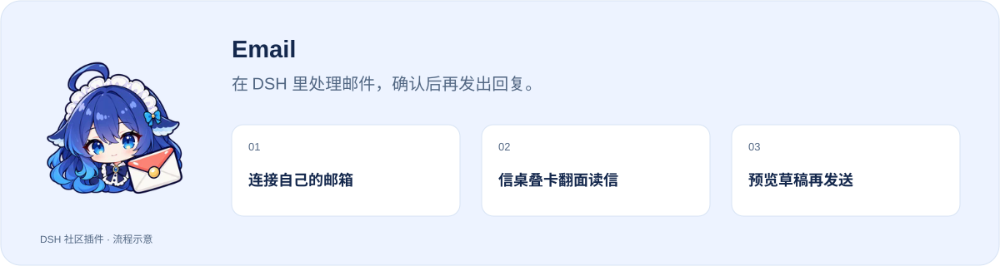

**简体中文** · [English](README.en.md)

# Email

> **在 DeepSeek Harness 中安全收发多账号邮件，核对草稿后再立即或定时发送。**

默认进入 **「信桌」实体航空书信分拣台**（1 键切回经典三栏），支持全协议多账号、本地 SQLite 通讯录拼音补全、互动鲸鱼娘「信使」与 13 套风格 / 8 套双层字体。

[](https://www.npmjs.com/package/dsh-email) [](https://www.npmjs.com/package/dsh-email) [](https://www.npmjs.com/package/dsh-email)

**[核心能力](#核心能力) · [安装](#安装) · [快速上手](#开始使用) · [完整说明](https://github.com/STARDUSTLC666/dsh-email/blob/main/docs/REFERENCE.zh.md)**

<picture>
  <source media="(prefers-color-scheme: dark) and (max-width: 640px)" srcset="https://raw.githubusercontent.com/STARDUSTLC666/dsh-email/main/docs/assets/intro/workflow-zh-mobile-dark.svg">
  <source media="(max-width: 640px)" srcset="https://raw.githubusercontent.com/STARDUSTLC666/dsh-email/main/docs/assets/intro/workflow-zh-mobile-light.svg">
  <source media="(prefers-color-scheme: dark)" srcset="https://raw.githubusercontent.com/STARDUSTLC666/dsh-email/main/docs/assets/intro/workflow-zh-dark.svg">
  
</picture>

## 核心能力

| 模块 | 核心特性 |
| :--- | :--- |
| **全协议多账号** | 支持 IMAP / POP3 / SMTP、Google / Outlook OAuth、AgentMail、腾讯企业邮预设、**按域名一键自动识别服务器**（离线库 / MX 反查 / SRV / Autoconfig / ISPDB）与内网自定义端点 |
| **「信桌」叠卡分拣** | 3 层航空信纸叠卡（左滑跳过、右滑展开全文、`Space`/`F` 3D 翻面看信封头）；1 键切回经典「三栏」并保留层级未读角标，另可切到 Gmail 式「列表」单行视图（无第三栏，点开邮件整块阅读） |
| **安全读信与草稿发送** | 默认拦截外部追踪图，支持 HTML/纯文本草稿核对后立即发送或定时发送，收件人禁止规则优先；支持 IMAP 文件夹管理与撤销删信 |
| **本地拼音通讯录** | 读信自动收集往来地址，写信 To/Cc 支持姓名、邮箱、全拼、拼音首字母与工号补全，数据仅保存在本机 SQLite |
| **信使互动与扩展能力** | 顶栏可召唤互动鲸鱼娘「信使」一键查新信；支持 8 种界面语言、13 套风格 × 8 套字体、进程内 `emailTasks` 订阅与可选「邮件任务」（默认关闭） |

<details>
<summary>查看工作台实景截图（信桌航空信叠卡）</summary>


截图来自 Harness Web `0.2.2-rc.3` 中运行的 `dsh-email 0.32.0`（信桌分拣台 + 默认幼圆等宽字体，使用受控示例数据）。

</details>

## 安装

在 DSH 桌面版「插件」面板安装 `dsh-email`，或使用命令行：

```bash
dsh plugin --profile desktop add dsh-email
```

网页版将 `desktop` 改为 `web`，安装后重启 DSH。宿主要求：`>=0.2.2-rc.3`。

## 开始使用

1. **连接邮箱**：打开「邮件 → 邮箱账号」，选择内置服务商、OAuth、AgentMail 或自定义服务器，先「测试连接」再保存启用。
2. **「信桌」分拣与读信**：切到「收发邮件」按账号/文件夹/未读/附件筛选；左滑跳过、右滑展开全文，按 `Space`/`F` 查看原始信封头，随时 1 键切回经典「三栏」。
3. **AI 协同起草**：点顶栏「信使」一键查新信，或在对话中让助手汇总未读与起草回复存入「草稿」（绝不越权直接发信）。
4. **核对与发送**：在「写邮件」或「草稿」中借助拼音通讯录补全收件人，核对正文与附件后确认**立即发送**或**定时发送**。

### 常用对话示例

- **汇总未读待办**：`汇总我工作邮箱里的未读重要邮件，按紧急程度列出待回复事项，先不要发送任何邮件。`
- **起草回复草稿**：`帮我针对刚才点开的这封邮件起草一封得体、简洁的回复草稿，存进草稿箱让我核对后再发。`

## 开始前要知道

- 需自备邮箱授权码、OAuth 客户端（Gmail 需自建 Desktop app）或 AgentMail API Key；如需代理可配账号 `proxy` 或 `HTTPS_PROXY`（见 [使用说明](https://github.com/STARDUSTLC666/dsh-email/blob/main/docs/USAGE.md)）。
- 定时发送需保持 DSH 运行；自动邮件任务与结果回复默认关闭。
- 详细边界见 [图文邮件、定时发送与邮件任务](docs/OUTGOING-AUTOMATION.md) 与 [邮箱操作流程](docs/MAILBOX.md)。

## 插件更新

在工作台或原生插件详情页底部检查更新。默认自动检查，**默认不自动安装**；Suite 管理的组件随整包更新。

## 文档与反馈

- [完整使用、配置与边界](https://github.com/STARDUSTLC666/dsh-email/blob/main/docs/REFERENCE.zh.md) · [更新记录](https://github.com/STARDUSTLC666/dsh-email/blob/main/CHANGELOG.md) · [验证历史](https://github.com/STARDUSTLC666/dsh-email/blob/main/docs/VALIDATION.md)
- 欢迎 Star、提交 [Issues](https://github.com/STARDUSTLC666/dsh-email/issues)（反馈请附版本与复现步骤，并移除凭据）。

## License

[MIT](https://github.com/STARDUSTLC666/dsh-email/blob/main/LICENSE)

<a id="依赖与配置"></a>
