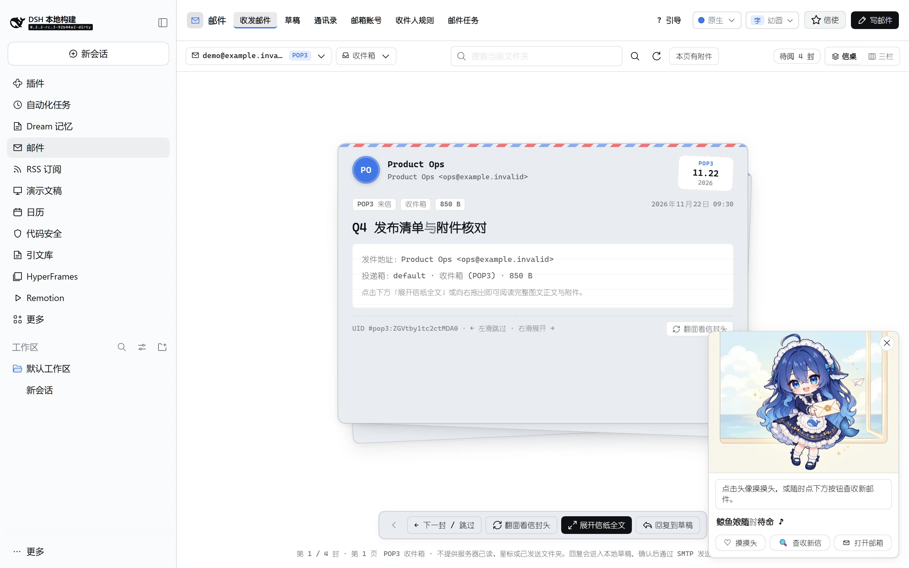

**简体中文** · [English](README.en.md)

# Email

**DeepSeek Harness 邮件工作台：默认「信桌」实体航空书信分拣台（1 键切回经典三栏）、图文回复草稿、本地通讯录拼音补全、互动鲸鱼娘信使与 13 套明亮风格 / 8 套双层字体实时切换。**

[](https://www.npmjs.com/package/dsh-email) [](https://www.npmjs.com/package/dsh-email) [](https://www.npmjs.com/package/dsh-email)

**[安装使用](#安装) · [使用流程](#开始使用) · [完整说明](https://github.com/STARDUSTLC666/dsh-email/blob/main/docs/REFERENCE.zh.md)**

<picture>
  <source media="(prefers-color-scheme: dark) and (max-width: 640px)" srcset="https://raw.githubusercontent.com/STARDUSTLC666/dsh-email/main/docs/assets/intro/workflow-zh-mobile-dark.svg">
  <source media="(max-width: 640px)" srcset="https://raw.githubusercontent.com/STARDUSTLC666/dsh-email/main/docs/assets/intro/workflow-zh-mobile-light.svg">
  <source media="(prefers-color-scheme: dark)" srcset="https://raw.githubusercontent.com/STARDUSTLC666/dsh-email/main/docs/assets/intro/workflow-zh-dark.svg">
  
</picture>

## 功能

- 使用 IMAP / POP3 / SMTP、Google / Outlook OAuth 或 AgentMail 账号，提供腾讯企业邮预设。
- 内置服务商与「服务器预设」之外，服务商下拉还提供「自定义服务器（手动填写）」：内网 / 自建邮件服务器可直接填 IMAP/SMTP 端点，发信主机留空沿用收信主机，端口留空按 993/465 处理。
- **「信桌」实体书信分拣台（默认，1 键切回经典「三栏」）**：收件箱化作 3 层航空信纸实体叠卡，左滑跳过下一封、右滑展开信纸全文，点「翻面看信封头」3D 查看原始信封元数据，点「展开信纸全文」阅读安全图文正文与附件；内置 **13 套明亮/柔和工作台风格**与 **8 套中英双层字体（默认「幼圆等宽」）**，跨插件自动同步，顶栏点 **`? 引导`** 可交互式走完新手流程。
- **互动鲸鱼娘「信使」**：顶栏右上角点击「信使」随时召唤鲸鱼娘，摸摸头触发三组心情表情与粒子彩蛋，支持一键「查收新信」与直达收件箱。
- 本地通讯录：读信时自动收集往来地址，发件人 / 收件人按通讯录姓名渲染；写信时 To/Cc 支持姓名、邮箱、全拼、拼音首字母与工号自动补全并带出姓名（例如 `张小` / `zxm` / `zhangxiaoming` / `100123` 都能找到同一个人），数据只保存在本机 SQLite 文件里。
- 管理 IMAP 自建文件夹与层级未读数：支持折叠树、单文件夹未读角标与打开自动已读（`markReadOnOpen`），可创建、重命名，预览并单独确认清空，只删除空文件夹；系统目录受保护。
- 界面跟随 DSH 语言：简体中文、英语、西班牙语、法语、德语、日语、巴西葡萄牙语和俄语。
- 其他插件可在进程内用 `emailTasks` 订阅新邮件到达，不读取正文、不创建会话。
- 编辑 HTML 或纯文本回复与草稿，核对发件账号、To/Cc、正文和附件后立即发送或定时发送。
- 可选「邮件任务」：从授权邮箱给允许的工作区发起 DSH 任务，并接续原会话；默认关闭。

新增功能的完整流程和边界见[图文邮件、定时发送与邮件任务](docs/OUTGOING-AUTOMATION.md)。Gmail OAuth 需自行创建 Google Desktop app 客户端；应用密码是否可用仍取决于账号策略。定时发送需保持 DSH 运行；自动邮件任务与结果回复均须主动启用。

<details>
<summary>查看实际示例</summary>



截图来自 Harness Web `0.2.2-rc.3` 中运行的 `dsh-email 0.32.0`（「信桌」实体书信分拣台 + 默认「幼圆等宽」字体，使用受控示例数据）。

</details>

图文阅读、长原文回复，以及 IMAP 单封 / 批量移入废纸篓与撤销，见[邮箱操作流程](docs/MAILBOX.md)。外部图片由你选择加载，邮件整理先预览确认。

## 安装

在 DSH 桌面版「插件」面板安装 `dsh-email`。已配置命令行时也可使用：

```bash
dsh plugin --profile desktop add dsh-email
```

网页版把 `desktop` 改为 `web`；安装后重启对应的 DSH。宿主要求以包声明 `>=0.2.2-rc.3` 为准。

## 开始使用

**核心协作闭环：连接邮箱 → 「信桌」叠卡分拣与翻面读信 → 召唤「信使」/ AI 协同起草 → 核对后立即或定时发送**（首次打开可点顶栏 **`? 引导`** 跟随聚光灯交互上手）：

1. **连接邮箱**：打开「邮件 → 邮箱账号」，选择内置服务商（QQ、163、腾讯企业邮、Gmail、Outlook OAuth、AgentMail 或自定义服务器），填写授权码或完成 OAuth 登录后点击「测试连接」。
2. **「信桌」叠卡分拣与安全读信（1 键切换经典「三栏」）**：
   - 切到「收发邮件」默认进入**「信桌」**视图：顶部紧凑检索条集成账号/文件夹（含层级与未读角标）、关键词搜索、「只看未读」、「本页有附件」、「待阅」计数与右侧 **「信桌 / 三栏」** 1 键切换。
   - 中间为 3 层实体航空信纸卡片：**左滑跳过下一封、右滑直接展开信纸全文**；点击「翻面看信封头」（或按 `Space`/`F`）3D 翻转查看原始信封与服务器元数据；点「展开信纸全文」阅读安全图文正文、下载附件与回复到草稿（外链追踪图片默认拦截，按需为单封放行）。
3. **互动鲸鱼娘「信使」与 AI 协作草稿**：随时点右上角「信使」召唤鲸鱼娘摸摸头互动或一键「查收新信」；也可在 `? 引导` 或对话中直接发指令让助手汇总未读与待办、针对来信起草得体回复并存入「草稿」（绝不越权直接发出）。
4. **通讯录补全、确认发送与个性化外观**：点「写邮件」或在「草稿」中编辑（To/Cc 支持本地通讯录姓名/全拼/首字母/工号补全），核对发件账号、收件人、图文预览与附件后确认**立即发送**或**定时发送**（收件人禁止规则始终优先）。顶栏支持实时切换 **13 套明亮风格**与 **8 套中英双层字体（`字`，默认「幼圆等宽」）**，跨所有插件自动同步。

也可以直接在对话里这样对助手说：

- > 汇总我工作邮箱里的未读重要邮件，按紧急程度列出待回复事项，先不要发送任何邮件。
- > 帮我针对刚才点开的这封邮件起草一封得体、简洁的回复草稿，存进草稿箱让我核对后再发。

## 开始前要知道

需要自己的邮箱授权或 AgentMail API Key；POP3 的状态与搜索范围按协议说明。网络必须经代理才能连上邮箱服务器时，给账号加 `proxy`（或用 `HTTPS_PROXY`），见[使用说明](https://github.com/STARDUSTLC666/dsh-email/blob/main/docs/USAGE.md)。

配置、完整工具与排错见[详细使用说明](https://github.com/STARDUSTLC666/dsh-email/blob/main/docs/REFERENCE.zh.md)。

## 插件更新

在工作台或原生插件详情页底部检查更新。默认自动检查，**默认不自动安装**；是否安装、何时重启由你决定。Suite 管理的组件随整包更新。[查看更新规则](https://github.com/STARDUSTLC666/dsh-email/blob/main/docs/REFERENCE.zh.md)。

## 文档

- [详细使用、配置与边界](https://github.com/STARDUSTLC666/dsh-email/blob/main/docs/REFERENCE.zh.md)
- [更新记录](https://github.com/STARDUSTLC666/dsh-email/blob/main/CHANGELOG.md)
- [验证范围与历史](https://github.com/STARDUSTLC666/dsh-email/blob/main/docs/VALIDATION.md)

## 反馈与贡献

如果插件帮到了你，欢迎 Star，让更多人发现它。问题和建议请提交 [Issues](https://github.com/STARDUSTLC666/dsh-email/issues)，也欢迎代码与文档 [PR](https://github.com/STARDUSTLC666/dsh-email/pulls)。反馈时附上版本与复现步骤，并移除凭据。

## License

[MIT](https://github.com/STARDUSTLC666/dsh-email/blob/main/LICENSE)

<a id="依赖与配置"></a>
